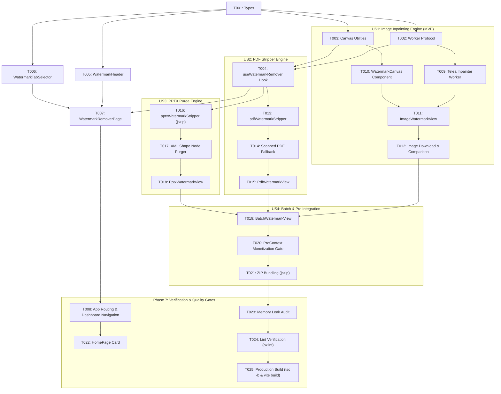

# Tasks: Xóa Watermark Đa Nền Tảng (Image, PDF, PPTX)

**Input**: Design documents from `specs/001-watermark-remover/` (spec.md, plan.md)  
**Prerequisites**: plan.md (completed), spec.md (completed), constitution.md (ratified)  
**Organization**: Tasks are grouped by phase and user story to enable independent execution, incremental validation, and verification against the Cytools Constitution.

---

## Format: `[ID] [P?] [Story] Description`
- **[P]**: Can run in parallel (different files, no blocking dependencies)
- **[Story]**: Maps task to User Story (US1: Image Inpainting, US2: PDF Stripper, US3: PPTX Purge, US4: Batch & Pro, US5: UI Parity)

---

## Phase 1: Setup (Shared Infrastructure)

**Purpose**: Type definitions, worker scaffolding, and shared canvas utilities.

- [ ] **T001** `[P]` `[Setup]` Create TypeScript interface definitions in [`src/types/watermarkRemover.ts`](file:///d:/Aiotools/web-utility-hub/src/types/watermarkRemover.ts) defining `WatermarkFileType`, `ImageMaskData`, `PdfWatermarkOptions`, `PptxWatermarkOptions`, `BatchWatermarkItem`, and `ProcessingState`.
- [ ] **T002** `[P]` `[Setup]` Create Web Worker initialization module [`src/workers/watermarkInpainter.worker.ts`](file:///d:/Aiotools/web-utility-hub/src/workers/watermarkInpainter.worker.ts) with typed message protocol (`INPAINT_REQUEST`, `INPAINT_PROGRESS`, `INPAINT_SUCCESS`, `INPAINT_ERROR`).
- [ ] **T003** `[P]` `[Setup]` Implement canvas mask drawing and coordinate scaling helpers in [`src/utils/canvasMaskUtils.ts`](file:///d:/Aiotools/web-utility-hub/src/utils/canvasMaskUtils.ts) for brush strokes, eraser, clear mask, and rectangular selection.

---

## Phase 2: Foundational (Blocking Prerequisites)

**Purpose**: Core state machine, navigation links, and layout structure.

- [ ] **T004** `[Foundation]` Create custom hook [`src/hooks/useWatermarkRemover.ts`](file:///d:/Aiotools/web-utility-hub/src/hooks/useWatermarkRemover.ts) managing active sub-tool (`image` | `pdf` | `pptx` | `batch`), active files, object URL lifecycle tracking, and worker job cancellation.
- [ ] **T005** `[P]` `[US5]` Create header component [`src/components/watermark-remover/WatermarkHeader.tsx`](file:///d:/Aiotools/web-utility-hub/src/components/watermark-remover/WatermarkHeader.tsx) with Lucide `Sparkles` icon, title, description, and client-side privacy badge in Slate dark mode styling.
- [ ] **T006** `[P]` `[US5]` Create tab navigation component [`src/components/watermark-remover/WatermarkTabSelector.tsx`](file:///d:/Aiotools/web-utility-hub/src/components/watermark-remover/WatermarkTabSelector.tsx) with Framer Motion `layoutId="watermarkTabIndicator"` animated pills matching `SocialDownloaderPage.tsx`.
- [ ] **T007** `[Foundation]` Create master page container [`src/pages/WatermarkRemoverPage.tsx`](file:///d:/Aiotools/web-utility-hub/src/pages/WatermarkRemoverPage.tsx) assembling header, tab selector, and view slots with `usePro()` integration.
- [ ] **T008** `[Foundation]` Register route `/watermark-remover` in [`src/App.tsx`](file:///d:/Aiotools/web-utility-hub/src/App.tsx) and add sidebar navigation item with `Sparkles` icon in [`src/components/layout/DashboardLayout.tsx`](file:///d:/Aiotools/web-utility-hub/src/components/layout/DashboardLayout.tsx).

---

## Phase 3: User Story 1 - Image Watermark Removal (Priority: P1) [MVP]

**Goal**: Full in-browser canvas brush selection and Telea inpainting for PNG, JPG, and WebP images.

- [ ] **T009** `[US1]` Implement pure TypeScript Fast Marching Method (Telea algorithm) in [`src/workers/watermarkInpainter.worker.ts`](file:///d:/Aiotools/web-utility-hub/src/workers/watermarkInpainter.worker.ts) using `ImageData` pixel buffers, distance map transform, and weighted boundary synthesis.
- [ ] **T010** `[US1]` Build interactive canvas component [`src/components/watermark-remover/WatermarkCanvas.tsx`](file:///d:/Aiotools/web-utility-hub/src/components/watermark-remover/WatermarkCanvas.tsx) featuring responsive scaling, custom brush cursor, brush radius slider (5px-80px), undo/redo stroke stack, and touch support.
- [ ] **T011** `[US1]` Build split before/after comparison component [`src/components/watermark-remover/WatermarkComparisonSlider.tsx`](file:///d:/Aiotools/web-utility-hub/src/components/watermark-remover/WatermarkComparisonSlider.tsx) matching Cytools Slate aesthetic.
- [ ] **T012** `[US1]` Build [`src/components/watermark-remover/ImageWatermarkView.tsx`](file:///d:/Aiotools/web-utility-hub/src/components/watermark-remover/ImageWatermarkView.tsx) orchestrating drag-and-drop dropzone, canvas editor, inpainting execution button, loading spinner (`Loader2`), and high-res export download button.

**Checkpoint**: At this point, Image Watermark Removal is a 100% functional standalone MVP.

---

## Phase 4: User Story 2 - PDF Watermark & Stamp Stripping (Priority: P1)

**Goal**: Vector and text watermark elimination across PDF pages via client-side `pdf-lib`.

- [ ] **T013** `[US2]` Implement PDF stream parser and artifact stripper in [`src/utils/pdfWatermarkStripper.ts`](file:///d:/Aiotools/web-utility-hub/src/utils/pdfWatermarkStripper.ts) using `pdf-lib` to inspect page content streams, strip `/Artifact` and `/Watermark` tagged blocks, remove recurring diagonal rotation matrices, and sanitize page object trees.
- [ ] **T014** `[US2]` Add scanned PDF raster detection in [`src/utils/pdfWatermarkStripper.ts`](file:///d:/Aiotools/web-utility-hub/src/utils/pdfWatermarkStripper.ts) to identify single-image pages and provide "Tách ảnh & Khử Watermark" fallback.
- [ ] **T015** `[US2]` Build [`src/components/watermark-remover/PdfWatermarkView.tsx`](file:///d:/Aiotools/web-utility-hub/src/components/watermark-remover/PdfWatermarkView.tsx) with PDF file dropzone, page thumbnail grid rendered via `pdfjs-dist`, page selection checkboxes (All vs Custom Range), execution progress bar, and instant download.

**Checkpoint**: User Stories 1 and 2 operate independently and 100% in-browser.

---

## Phase 5: User Story 3 - PPTX Watermark & Master Slide Purge (Priority: P2)

**Goal**: In-memory OpenXML PowerPoint archive inspection and shape node sanitization via `jszip`.

- [ ] **T016** `[US3]` Implement OpenXML PPTX unpacker and DOM sanitizer in [`src/utils/pptxWatermarkStripper.ts`](file:///d:/Aiotools/web-utility-hub/src/utils/pptxWatermarkStripper.ts) using `jszip` to traverse `ppt/slides/slide*.xml`, `ppt/slideMasters/slideMaster*.xml`, and `ppt/slideLayouts/slideLayout*.xml`.
- [ ] **T017** `[US3]` Implement XML shape element purger in [`src/utils/pptxWatermarkStripper.ts`](file:///d:/Aiotools/web-utility-hub/src/utils/pptxWatermarkStripper.ts) targeting `<p:sp>` with watermark names, semi-transparent text, and large diagonal watermark background shapes, then repackage into a valid `.pptx` Blob.
- [ ] **T018** `[US3]` Build [`src/components/watermark-remover/PptxWatermarkView.tsx`](file:///d:/Aiotools/web-utility-hub/src/components/watermark-remover/PptxWatermarkView.tsx) with presentation upload card, slide count indicator, detected watermark details list, removal trigger, and clean `.pptx` download button.

**Checkpoint**: All three media formats (Images, PDFs, PPTX) have dedicated client-side engines.

---

## Phase 6: User Story 4 - Batch Queue & Pro Integration (Priority: P2)

**Goal**: Multi-file batch processing with worker pool and ZIP archive packaging.

- [ ] **T019** `[US4]` Build [`src/components/watermark-remover/BatchWatermarkView.tsx`](file:///d:/Aiotools/web-utility-hub/src/components/watermark-remover/BatchWatermarkView.tsx) supporting multi-file queue (up to 20 files) with file type badges, individual progress bars, and status icons (`CheckCircle2`, `AlertCircle`, `Loader2`).
- [ ] **T020** `[US4]` Integrate Pro gating using `usePro()`: free users can queue up to 3 files; adding >3 files triggers `openProModal('Nâng cấp Pro chỉ 5.000đ để xử lý hàng loạt không giới hạn!')`.
- [ ] **T021** `[US4]` Implement batch processing dispatcher in [`src/hooks/useWatermarkRemover.ts`](file:///d:/Aiotools/web-utility-hub/src/hooks/useWatermarkRemover.ts) processing files concurrently and packaging results into a downloadable `.zip` via `jszip`.

---

## Phase 7: Polish, Integration & Quality Gates

**Purpose**: Navigation discoverability, UI polish, memory verification, and build validation.

- [ ] **T022** `[P]` `[US5]` Add a quick-access tool card for Watermark Remover on [`src/pages/HomePage.tsx`](file:///d:/Aiotools/web-utility-hub/src/pages/HomePage.tsx) with Slate dark mode gradients and Lucide `Sparkles` icon.
- [ ] **T023** `[Polish]` Audit memory and resource hygiene: ensure all object URLs created via `URL.createObjectURL` are explicitly cleaned via `URL.revokeObjectURL` on unmount and file removal.
- [ ] **T024** `[Polish]` Run code quality gate: `npm run lint` (`oxlint`) and ensure zero errors or warnings.
- [ ] **T025** `[Polish]` Run build verification: `npm run build` (`tsc -b && vite build`) and confirm clean compilation.

---

## Dependencies & Execution Sequence

